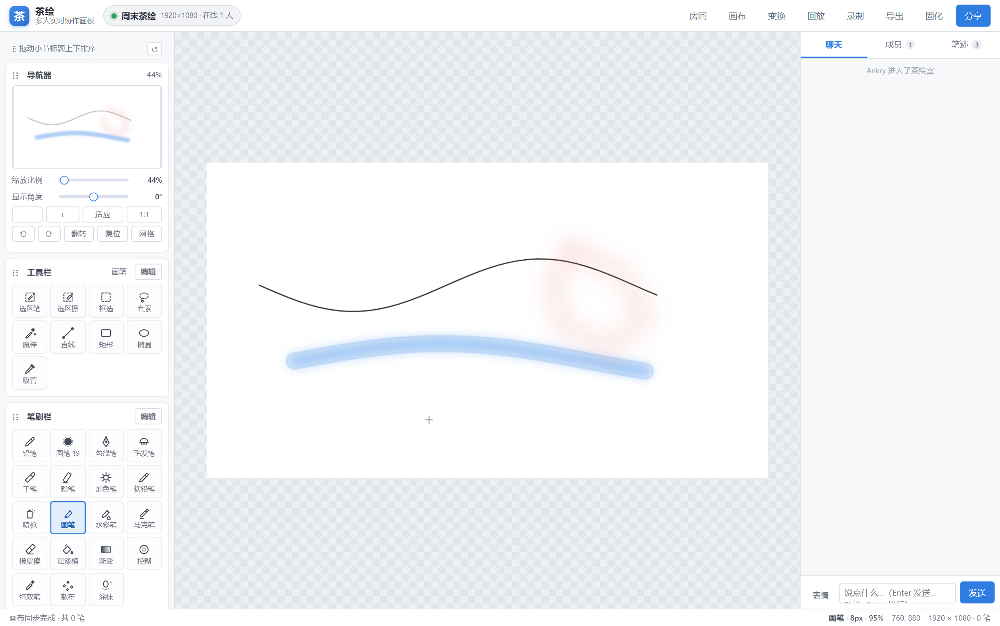
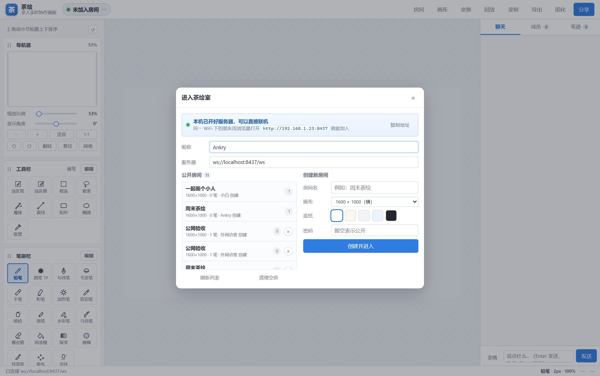

# 茶绘 · Chahui

> 多人实时协作绘画聊天室 —— 桌面（Electron）/ 安卓（Capacitor）/ 网页三端同一套界面，笔刷与面板对照 PaintTool SAI Ver.2。

开一个房间，把链接发给朋友，大家就能在同一张纸上一起画，边画边聊。所有笔迹实时同步，
每台机器都用同一套确定性渲染，**两端像素级一致**。



📹 [74 秒介绍视频](https://github.com/PainterAnkry/chahui/releases/download/v2.1.1/chahui-intro-1080p.mp4)

---

## 下载

直接去 **[Releases](https://github.com/PainterAnkry/chahui/releases/latest)** 拿现成的包：

| 文件 | 平台 | 说明 |
| --- | --- | --- |
| `chahui-setup-<版本>.exe` | Windows x64 | 安装版，可自选目录 |
| `chahui-portable-<版本>.exe` | Windows x64 | 免安装，双击即用 |
| `chahui-green-<版本>.zip` | Windows x64 | 绿色版：解压后双击 `茶绘.exe`（报 NSIS Error 的机器用这份） |
| `chahui-linux-<版本>-x86_64.AppImage` | Linux x64 | 通用版：`chmod +x` 后双击即用，无需安装 |
| `chahui-linux-<版本>-amd64.deb` | Debian/Ubuntu x64 | 安装版：双击用软件安装器打开，或 `sudo dpkg -i <文件>` |
| `chahui-linux-<版本>-x64.tar.gz` | Linux x64 | 绿色版：解压后运行 `./茶绘-绿色版-<版本>/chahui-desktop`（先 `chmod +x`） |
| `chahui-android-<版本>.apk` | Android 7.0+ | 安卓版，下载后直接安装 |
| `chahui-server-<版本>.tar.gz` | Linux | 自建服务端（解压覆盖 `server/` 即可） |

- 桌面端升级：「其他 → 关于 → 检查更新」会自己认出该下哪个包并直接下载
- 首次运行弹 SmartScreen 是未签名 exe 的正常提示，点「更多信息 → 仍要运行」即可
- Linux 的 AppImage 首次运行需先 `chmod +x chahui-linux-*-x86_64.AppImage`；Ubuntu 22.04+ 没预装 libfuse2 的，可改用 deb 包，或 `./chahui-linux-*-x86_64.AppImage --appimage-extract` 解压后运行

---

## 功能一览

**绘画**
- 22 支笔刷（铅笔 / 圆笔 / 水彩 / 马克 / 橡皮 / 油漆桶 / 渐变 / 模糊 / 涂抹 / 散布…），其中 12 支参数直接取自 SAI2 笔刷包
- 每支笔独立控制大小、浓度、边缘硬度、笔压曲线、抖动修正、混色；铅笔带纸纹、水彩笔会与底色融合
- 导入 Photoshop / CSP / Procreate / SAI2 / 画世界Pro 的笔刷（`.abr` `.sut` `.brush` `.saitdat` `.bru`），笔尖跟着笔迹同步，跨端笔触一致
- 尺子五种（直线 / 椭圆 / 平行线 / 同心圆 / 集中线）+ 对称尺、网格变换、液化、高斯模糊、色调调整滤镜、文字图层

**选区**
- 选区笔 / 选区擦、框选、套索（松手才闭合）、魔棒（SAI2 式选项面板：取样模式 / 容差 / 防止溢出 / 取样来源）
- `Shift` 加选、`Alt` 减选；蚂蚁线沿真实形状走，画笔画不出选区会明确提示

**图层与文件**
- 17 种混合模式、不透明度、保护不透明度、四把锁
- 图层组（组参数对成员只作用一次）、图层蒙版 / 剪贴蒙版（非破坏，能进 PSD 也能读回来）
- 工程文件 `.chahu`（画布 + 图层 + 像素，换机器接着画）+ 崩溃自动恢复
- 导出 png / jpg / webp / bmp / tga，以及**带图层和图层组的 PSD**（也能导入 PSD）

**协作**
- 房间列表、密码房间、头像、成员列表、实时聊天 + 表情包、远端光标
- 只读观众（服务端拦截写操作）、他人笔触淡化 / 单人隐藏（纯本机显示）
- 作画过程回放（逐笔生长、洋葱皮、作者标注、倍速、一键导出视频）

**联机小游戏**（房间内开局，玩完接着画）
- **你画我猜**：轮流派画手，猜对得分，卡住自动露字
- **接龙 / 传词接龙**：画→猜→画接力，逐链回放投票
- **画皮**：夜里验人、白天投票的绘画狼人杀
- 15 套主题词库 + 自建词库；答案与题面全走服务端私有消息，想作弊也没得扒

**界面**
- 浅色 / 深色主题（默认跟随系统）、SAI2 式菜单栏、快捷键可改、面板可拖动排序 / 拖成浮窗

---

## 快速开始

### 桌面版：双击即用

1. 双击「茶绘」（内置服务器自动启动，默认 8437 端口）
2. 创建房间，点「分享」或「复制地址」
3. 同一 WiFi 下的朋友**用浏览器打开那个链接**就进来一起画（他们什么都不用装）



### 公网联机

- **桌面端**：房间信息面板点「开启公网联机」，App 自动起一条 cloudflared 快速隧道，复制公网链接发出去即可（不用装任何额外软件）
- **安卓 / 网页端房主**：优先走 **WebRTC P2P 直连**（点对点，不经过服务器）；打洞失败时可回落到**你自己配置的服务端**当哑中继（在 `client/renderer/config.js` 的 `publicServer` 填自建地址即可）。官方公共服务器已下线，不再提供默认中继
- **网页端访客**：需要一台托管了网页版的服务端来打开页面（自建 `server/` 或任意静态托管）；装了茶绘的桌面 / 安卓端则可以直接用 `chahui://` 应用链接进房
- 命令行方式：`npm run expose`（服务端跑着的情况下，一条命令开临时隧道）
- 有公网服务器的话直接部署 `server/`，大家访问 `http://<公网地址>:8437`

### 自建服务端 / 网页版

```bash
npm install --prefix server
npm run server          # 默认监听 0.0.0.0:8437
```

浏览器打开 `http://localhost:8437` 就是网页版。环境变量（`PORT` / `DATA_DIR` / `MAX_ROOMS` /
限流等）都有默认值，见 `server/src/index.js` 头部注释。

---

## 常用快捷键

| 操作 | 快捷键 |
| --- | --- |
| 撤销 / 重做 | `Ctrl+Z` / `Ctrl+Y` |
| 全选 / 取消 / 反选 | `Ctrl+A` / `Ctrl+D` / `Ctrl+I` |
| 变换 | `Ctrl+T`，`Enter` 确定、`Esc` 中止 |
| 新建图层 | `Ctrl+Shift+N` |
| 导出 PNG | `Ctrl+S` / `Ctrl+E` |
| 工具 | `B` 画笔 `E` 橡皮 `U` 模糊 `S` 涂抹 `G` 油漆桶 `N` 渐变 `W` 魔棒，按住 `Alt` 临时吸管 |
| 抓手 / 平移 | 空格 + 左键拖动（或中键；触屏单指拖画布） |
| 笔刷大小 | `[` / `]` |
| 前景 / 背景互换 | `X`（`D` 回到黑 / 白） |
| 缩放 | 滚轮 |

---

## 开发

需要 Node.js 18+。

```bash
npm run sync            # 同步协议 + 前端 + 服务端（改代码后必跑）
npm run check           # CSS / 函数 / 元素 id / 协议接线静态检查
npm test                # 双虚拟客户端端到端（不需要浏览器）
npm run test:browser    # Chrome 双上下文端到端（含两端像素比对）
npm run test:all        # 一次跑完全部浏览器类回归
```

**四个「唯一来源」**：协议只改 `shared/protocol.js`、前端只改 `client/renderer/`、
服务端只改 `server/src/`、界面样式遵循 `docs/DESIGN.md` 的设计令牌 ——
改完跑 `npm run sync`（漏同步 `server/public/` 网页版就是旧代码）。

桌面端开发与打包：

```bash
npm install --prefix client && npm run client   # Electron 开发模式
npm run dist                                    # 打包 Windows 三件套到 dist/
```

安卓端（Capacitor 壳，同一份 `client/renderer`）：

```bash
cd client-android && npm install && npm run sync
cd android && gradlew.bat assembleRelease       # JDK 21 + Android SDK
```

`tools/` 里有同步、测试、验收、截图等脚本；测试大多接受服务端地址作为第一个参数，
例如 `node tools/test-panels.js http://127.0.0.1:8440`。浏览器类测试需要一个
`playwright-core`（不下载浏览器，用本机 Chrome）。

---

## 许可

[MIT](LICENSE)
